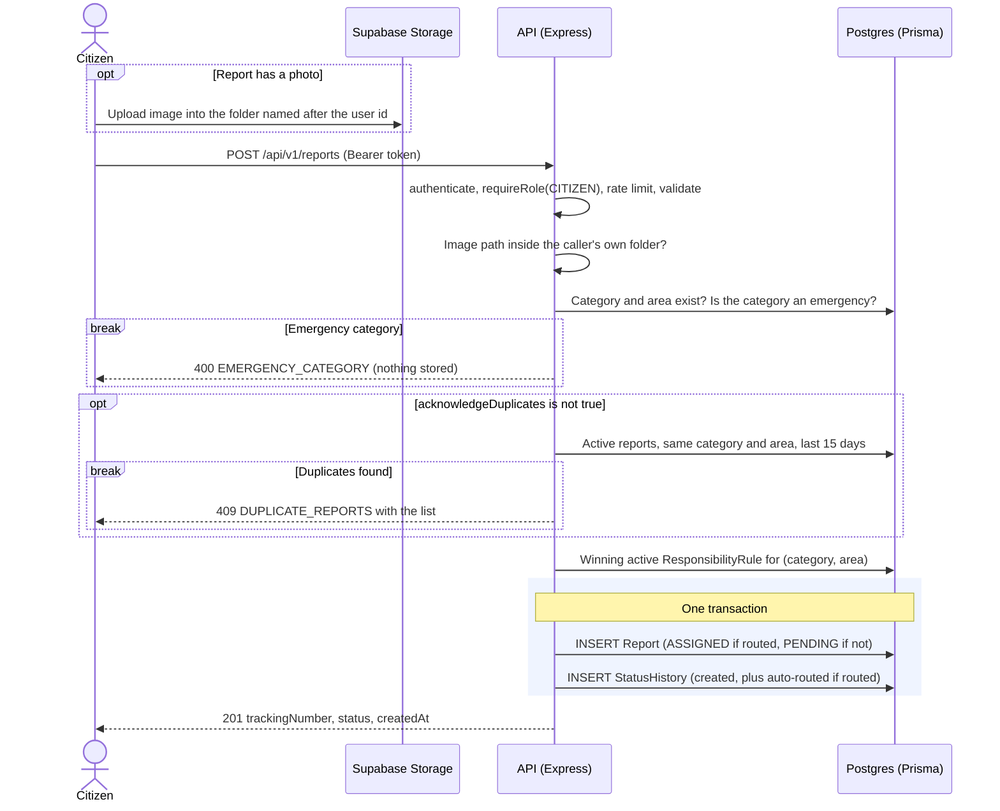
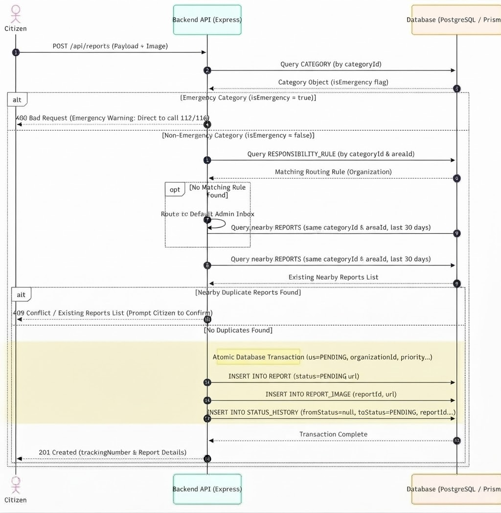
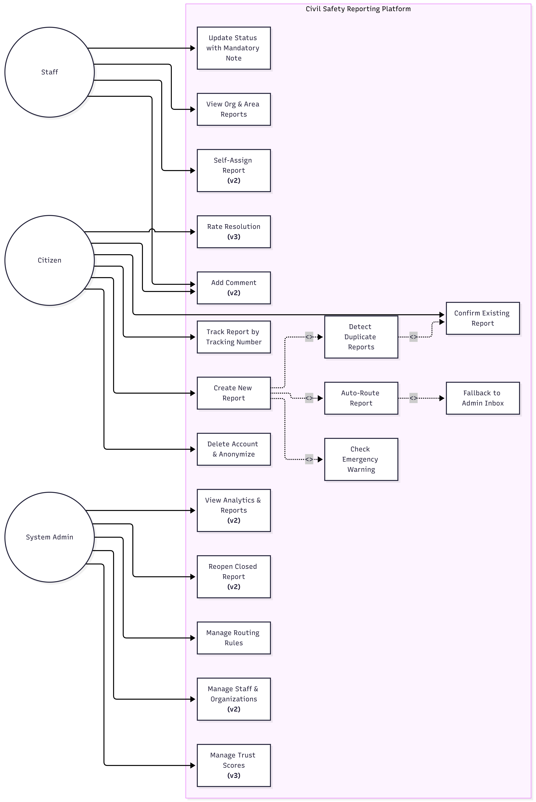
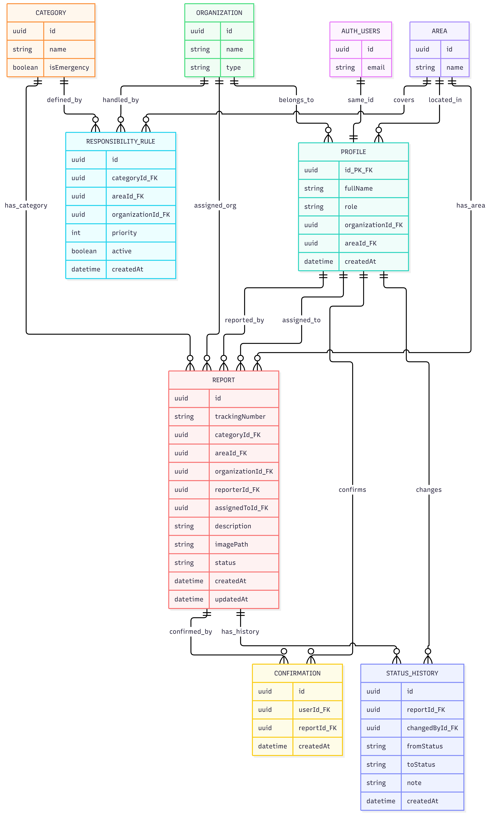

# Urban Safety Reporting Platform — Backend API

A REST API that lets citizens report **non-emergency** urban safety problems (a broken street light, a pothole, a water leak) and track them with a tracking number.
Each report is routed automatically to the responsible organization, whose staff move it through a strict, audited lifecycle.

---

## Highlights

- **Race-safe report lifecycle without locks.** A status change is one conditional `updateMany` that only matches if the report still has the status and assignee that were read, plus an audit row, in one transaction. When two staff members start the same report at the same moment, exactly one succeeds and the other gets `409 STATE_CHANGED`.
- **A trust boundary that can't be talked around.** Role, organization and area are loaded from the database on every request, never taken from the token payload or the request. Strict schemas turn a smuggled `role` field into a `400`, and staff queries are always scoped to their own organization **and** area.
- **Nothing is written until every check passes.** Report creation runs a fixed sequence (image path, references, emergency check, duplicate check, routing) and only then opens a single transaction. An emergency or a duplicate leaves no trace in the database.
- **Consistency across two systems.** An account lives in Supabase Auth and in Postgres, and no transaction spans both. If the second step fails, the first is undone (the auth user is deleted), so there are never accounts that can log in but can't do anything.
- **Integrity enforced by the database, not only by code.** `RESTRICT` foreign keys keep reports from losing their references, a `CHECK` constraint guarantees every staff profile has an organization and an area, unique constraints settle double clicks, and Row Level Security closes Supabase's public Data API.
- **Privacy by construction.** Every response is built from an explicit Prisma `select`, so reporter identity can't leak by accident. Public tracking shows only status, place, dates and the final note. Logs carry ids only: tokens and passwords are redacted, query strings dropped, and Prisma messages (which echo query values) stripped.
- **One error contract for the whole API.** Code throws typed errors with stable machine-readable codes, and a single handler turns them into one JSON shape. Unexpected failures are logged with the request id and answered with a generic `500`, never a stack trace.
- **Tested and documented.** 214 unit tests cover the state machine, every validation schema, pagination and tracking numbers. Strict TypeScript has no `any`. A full endpoint reference lives in [`docs/API.md`](docs/API.md), and a decision log ([`context/decisions.md`](context/decisions.md)) records what was chosen, what was rejected and why.

---

## Contents

1. [Tech Stack](#tech-stack)
2. [Architecture](#architecture)
3. [Key Features](#key-features)
4. [Database Schema](#database-schema)
5. [API Overview](#api-overview)
6. [Getting Started](#getting-started)
7. [Testing](#testing)
8. [Design Decisions & Future Work](#design-decisions--future-work)

---

## Tech Stack

| Layer | Choice | Why |
|---|---|---|
| Language | **TypeScript** (`strict`, no `any`) | Every source, test, seed and config file is `.ts` |
| Runtime / framework | **Node.js**, **Express 5** | Express 5 forwards rejected promises to the error handler, so no `try/catch` in controllers |
| Database | **PostgreSQL** on Supabase, via **Prisma** | Typed queries, migrations, and `select` constants that fix the shape of every response |
| Identity & files | **Supabase Auth** and **Supabase Storage** | Passwords, sessions, token refresh, password-reset emails and image hosting are handled by a managed service instead of custom code. The API stores no passwords |
| Validation | **Zod 4** | One schema per input, which validates *and* infers the TypeScript type. Also validates environment variables at boot |
| Security | **helmet**, **cors**, **express-rate-limit** | Security headers, CORS locked to one origin, per-IP and per-user limits |
| Logging | **pino** + **pino-http** | Structured JSON logs with a request id on every line, plus redaction |
| Testing | **Vitest** | Fast, TypeScript-native unit tests |
| Quality | **ESLint** (typescript-eslint), **Prettier** | One style across the codebase |

---

## Architecture

A **modular monolith organized by business domain**, not by role. There is no `staff/` or `citizen/` module: roles are permissions, enforced by middleware and by scoping queries to the caller.

```
routes  →  controller  →  service  →  Prisma / Supabase
(wiring)   (HTTP only)    (all business logic)
```

- **Routes** only wire middleware: `authenticate → requireRole → rateLimit → validate → controller`.
- **Controllers** read the already-validated input, call **one** service function and send the response. No business logic, no database access, no `try/catch`.
- **Services** hold all business rules. They never import Express, so they could be called from a script or a job unchanged.
- **One central error handler** turns every thrown error into the same JSON shape.

```
src/
├── config/        env.ts (the only reader of process.env), db.ts (single Prisma client), constants.ts
├── lib/supabase/  anon-client.ts, admin-client.ts (service role; imported by 3 files only)
├── modules/
│   ├── auth/            register, delete account
│   ├── profiles/        current user's profile
│   ├── reference-data/  categories, areas, organizations, routing rules
│   ├── reports/         create, track, confirm, list, detail, status changes
│   │                    + routing, dedup, safety-net, confirmation and state-machine services
│   └── admin/           create staff accounts
├── middlewares/   auth, role, validate, rate-limit, error-handler
├── errors/        AppError + 7 subclasses
├── utils/         logger, pagination, tracking-number
├── app.ts         builds the Express app (no listen, so it can be imported)
└── server.ts      starts the HTTP server
prisma/            schema, migrations, idempotent seed (sample data + the single admin)
tests/unit/        Vitest unit tests
docs/API.md        full endpoint reference
```

### Request flow: creating a report



The create-report flow as implemented in v1. Every check runs **before** anything is written, so an emergency, a duplicate or an invalid image path leaves nothing in the database. Only then are the report and its history saved in **one transaction**. A report with no matching routing rule is still stored, as `PENDING` with no organization, so the citizen always gets a tracking number. The admin then sees it and closes it with a note.

<details>
<summary>Early design sketch of the same flow</summary>



The first sketch, drawn before implementation. The idea held (checks first, one transaction last), but the details changed during the build:

- The **duplicate check now runs before routing**.
- The window is **15 days** instead of 30, counting only active reports.
- The image is uploaded straight to Supabase Storage, and the report keeps only its path: there is **no `REPORT_IMAGE` table**.
- Routed reports are stored as `ASSIGNED`, with an extra history row recording the automatic routing.

</details>

---

## Key Features



The three actors and what each can do. Items marked **(v2)** or **(v3)** are planned and **not** implemented; they are listed under [Future Work](#future-work). In v1:

- **Self-assign** happens implicitly: a staff member who starts or rejects an `ASSIGNED` report becomes its assignee.
- **"Manage staff"** means creating staff accounts. The admin can also list organizations, but not edit them.

### Authentication and roles
- Supabase issues the access token. The API validates it on every request, then loads the user's **Profile row from the database**. **Role, organization and area always come from that row**, never from the token payload or the request, so a tampered request cannot widen access.
- Three roles: `CITIZEN` (self-registers), `STAFF` (created by the admin, bound to one organization and one area), `ADMIN` (exactly one, created by the seed; no endpoint can create an admin).
- **Data scoping:** staff see and change only reports of their own organization **and** area. A report outside that scope returns the same `404` as a missing one, so staff cannot probe other areas.

### Report lifecycle (state machine)


The full lifecycle as designed across versions. **v1 implements only the core path**: `PENDING → ASSIGNED → IN_PROGRESS → RESOLVED / REJECTED`. `WAITING_FOR_INFO`, `CLOSED`, reopening and the timed auto-close/auto-reject are planned (see [Future Work](#future-work)). In v1, `RESOLVED` and `REJECTED` are final, and rejecting a `PENDING` report is the admin's action (for unrouted reports).

| From | To | Who | Rule |
|---|---|---|---|
| *(creation)* | `PENDING` → `ASSIGNED` | system | Automatic when a routing rule matches. No request can make this move |
| `ASSIGNED` | `IN_PROGRESS` | staff | Report must be unassigned; the caller becomes the assignee |
| `ASSIGNED` | `REJECTED` | staff | Same, with a required note |
| `IN_PROGRESS` | `RESOLVED` / `REJECTED` | staff | Only the assignee; note required |
| `PENDING` | `REJECTED` | admin | Unrouted reports only; note required |

- The table is **data** (`ALLOWED_TRANSITIONS`), checked by a pure function and covered by unit tests.
- **Race-safe:** a status change is a conditional `updateMany` that only matches if the report still has the status and assignee that were read, plus a `StatusHistory` insert, in one transaction. If two staff start the same report at once, one wins and the other gets `409 STATE_CHANGED`.
- **Audited:** every change writes a `StatusHistory` row with actor, note and time. Reports are never deleted.

### Reporting flow
- **Automatic routing** by `(category, area)` through admin-managed `ResponsibilityRule`s. The lowest priority number wins.
- **Emergency safety net:** a report in an emergency category is rejected with a clear message (`400 EMERGENCY_CATEGORY`) and **nothing is stored**.
- **Duplicate detection:** if active reports exist for the same category and area, the API returns `409 DUPLICATE_REPORTS` with the list. The citizen can confirm an existing one ("me too") or resubmit with `acknowledgeDuplicates: true`.
- **Confirmations** are counted on read, never stored as a counter. A unique `(user, report)` constraint makes a double click count once.
- **Public tracking** by an unguessable tracking number (`TRK-` + 10 Crockford base32 characters). It returns only status, category, area, dates and the final note.

### Validation
- Every body, query and params object goes through a **Zod** schema via one `validate()` middleware.
- All schemas are **`.strict()`**: an unknown field, such as a smuggled `role`, is a `400`.
- Validation errors list field paths and messages but **never echo the rejected values**, which may be passwords.
- Environment variables are validated at boot. The app refuses to start with a missing or invalid value and lists only the variable **names**.

### Error handling
- Code throws typed errors (`ValidationError`, `NotFoundError`, `ConflictError`, …), each with an HTTP status and a stable machine-readable `code`.
- One central error handler sends `{ "error": { "code", "message", "details?" } }` for every failure, including unknown routes, malformed JSON and `429`.
- Unexpected errors are logged with the request id and answered with a generic `500`. Stack traces and internal messages never reach the client.
- `try/catch` is used only where an error can be turned into something better: translating a unique-constraint violation into a `409`, retrying a tracking-number collision once, and **compensating** (deleting the Supabase user) when profile creation fails after sign-up.

### Security and privacy
- `helmet` headers, CORS limited to `CORS_ORIGIN`, and `trust proxy` set by a hop count (`TRUST_PROXY_HOPS`) so clients cannot spoof their IP to bypass rate limits.
- **Rate limits:** sign-up per IP, report creation per user, public tracking per IP. They return `429 RATE_LIMITED` in the standard error shape with `RateLimit` headers. Values live in `src/config/constants.ts`.
- **Row Level Security** is enabled on every table with no policies, so Supabase's public Data API can't read the tables. The API connects with a privileged role.
- The Supabase **service-role key** is used by only three files, and never leaves the server.
- **No reporter identity, emails or auth data** in any response. Every response is built from an explicit Prisma `select`.
- **Logs** carry ids, never emails, names or descriptions. Auth headers and password fields are redacted, query strings are dropped, and Prisma error messages (which echo query values) are stripped.

### Pagination
Every list that can grow is paginated (`page`, `limit`; default 20, max 100) with a stable sort and `meta.total`.

---

## Database Schema



Eight tables in Postgres. `AUTH_USERS` is Supabase's own `auth.users` table: a `Profile` shares its id, and deleting the auth user deletes the profile.

- **Report** is the core table. It references a category, an area, an optional organization (`null` = unrouted), the reporter and the assignee.
- **StatusHistory** is the audit trail: one row per status change.
- **ResponsibilityRule** maps `(category, area)` to an organization, with a priority.
- **Confirmation** records "me too", unique per `(user, report)`.

Integrity rules enforced **in the database**, not only in code:

- Foreign keys from reports and rules to organization, area and category are `RESTRICT`, so reference data that reports point to can't be deleted.
- Deleting a user keeps their reports and history (`SET NULL`) and removes their confirmations (`CASCADE`).
- A `CHECK` constraint: a `STAFF` profile must have an organization and an area.
- Unique constraints: tracking number, `(category, area, priority)` on rules, `(user, report)` on confirmations.
- Indexes match the main queries: the staff list, duplicate detection, and "my reports".

The init migration is generated by Prisma and then **hand-edited** for what Prisma can't express: the FK to `auth.users`, the `CHECK` constraint, and enabling RLS.

---

## API Overview

Base URL: `/api/v1`. Protected endpoints take `Authorization: Bearer <Supabase access token>`. Login, logout, token refresh and password reset are done by the frontend directly with Supabase.

| Method | Path | Description | Role |
|---|---|---|---|
| GET | `/health` | Liveness check | public |
| POST | `/auth/register` | Create a citizen account | public (rate-limited) |
| DELETE | `/auth/account` | Delete own account (reports are kept) | citizen, staff |
| GET | `/profiles/me` | Current user's profile and role | any |
| GET | `/categories` | Categories for the report form | any |
| GET | `/areas` | Areas for the report form | any |
| GET | `/organizations` | All organizations | admin |
| GET | `/responsibility-rules` | Routing table (paginated) | admin |
| POST | `/responsibility-rules` | Add a routing rule | admin |
| PATCH | `/responsibility-rules/:id` | Change organization, priority or active flag | admin |
| POST | `/reports` | File a report (emergency check, dedup, routing) | citizen (rate-limited) |
| GET | `/reports/track/:trackingNumber` | Public status lookup | public (rate-limited) |
| GET | `/reports/mine` | Own reports (paginated) | citizen |
| POST | `/reports/:id/confirm` | "Me too" on an active report | citizen |
| GET | `/reports` | Reports in scope; filter by status, category, unrouted | staff, admin |
| GET | `/reports/:id` | Report detail with image URL and history | staff, admin |
| PATCH | `/reports/:id/status` | Move a report through its lifecycle | staff, admin |
| POST | `/admin/staff` | Create a staff account for an organization and area | admin |

Response shapes:

```json
{ "data": { ... } }
{ "data": [ ... ], "meta": { "page": 1, "limit": 20, "total": 134 } }
{ "error": { "code": "STATE_CHANGED", "message": "Report state changed, reload it and try again" } }
```

**Full reference** with request fields, example responses and every error code: [`docs/API.md`](docs/API.md).

---

## Getting Started

### Prerequisites
- **Node.js 20.6 or newer** (the scripts use Node's built-in `--env-file`); an LTS release is recommended
- A **Supabase** project (free tier is enough)

### 1. Install
```bash
git clone <repository-url>
cd urban-safety-platform
npm install
```

### 2. Set up Supabase (dashboard)
1. **Storage:** create a bucket (for example `report-images`) with **public read**, a 5 MB limit and the types `image/jpeg`, `image/png`, `image/webp`. Add a policy on `storage.objects` that lets an authenticated user upload only into a folder named after their own user id.
2. **Auth:** choose whether sign-up requires email confirmation, and set the site/redirect URL used by password-reset emails.
3. Copy the project URL, the anon (publishable) key, the service-role (secret) key, and the **pooled** and **direct** database connection strings.

### 3. Configure the environment
```bash
cp .env.example .env
```
Then fill in `.env` (it's git-ignored; never commit it):

| Variable | Example / notes |
|---|---|
| `NODE_ENV` | `development`, `test` or `production` |
| `PORT` | `3000` |
| `LOG_LEVEL` | `info` (`fatal`, `error`, `warn`, `info`, `debug`, `trace`, `silent`) |
| `CORS_ORIGIN` | The frontend's origin, for example `http://localhost:5173` |
| `TRUST_PROXY_HOPS` | Optional, default `0`. Use `1` behind one proxy or load balancer (Render, AWS ALB) |
| `DATABASE_URL` | Supabase **pooled** connection string (used by the app) |
| `DIRECT_URL` | Supabase **direct** connection string (used by migrations) |
| `SUPABASE_URL` | `https://<project>.supabase.co` |
| `SUPABASE_ANON_KEY` | Public / publishable key |
| `SUPABASE_SERVICE_ROLE_KEY` | Secret / service-role key. Server only |
| `SUPABASE_STORAGE_BUCKET` | The bucket name from step 2 |
| `ADMIN_EMAIL`, `ADMIN_PASSWORD` | The single admin account the seed creates (password at least 8 characters) |

### 4. Create the schema and seed data
```bash
npx prisma migrate deploy   # applies the migrations (including FK to auth.users, CHECK and RLS)
npx prisma db seed          # sample categories, areas, organizations, routing rules + the admin
```
The seed is idempotent, so it's safe to run again. The migrations reference Supabase's `auth` schema, so they must run against a Supabase database.

### 5. Run
```bash
npm run dev                 # watch mode
# or
npm run build && node --env-file=.env dist/src/server.js
```
In production, set the variables in the host's environment instead of a `.env` file.
Check it: `GET http://localhost:3000/api/v1/health` → `{ "data": { "status": "ok" } }`.

### Scripts
| Command | Does |
|---|---|
| `npm run dev` | Start with auto-reload |
| `npm run build` | Compile TypeScript to `dist/` |
| `npm run typecheck` | Type-check without emitting |
| `npm run lint` | ESLint |
| `npm test` | Run the unit tests |

---

## Testing

```bash
npm test
```

**214 unit tests in 8 files**, run with Vitest. They cover the pure logic, with no network and no database:

| File | Covers |
|---|---|
| `state-machine.test.ts` | Every allowed transition and its assignee rule; terminal states; citizen, admin and backwards moves rejected |
| `tracking-number.test.ts` | Format, alphabet, uniqueness over a large sample |
| `pagination.test.ts` | Defaults, maximum limit, invalid input |
| `role.middleware.test.ts` | Role allow/deny |
| `auth.validation.test.ts`, `admin.validation.test.ts`, `reports.validation.test.ts`, `reference-data.validation.test.ts` | Every schema: boundaries, trimming, `.strict()` rejecting unknown fields such as `role`, the required note on final statuses |

Flows that need Supabase and the database (sign-up compensation, routing, the status-change race) are verified manually against a Supabase project. Automating them is the first item under [Future Work → Engineering](#engineering).

---

## Design Decisions & Future Work

### Key decisions

| Decision | Reason |
|---|---|
| Organize by domain, not by role | One place per business concept; the same report logic isn't split between a "staff" and an "admin" module |
| Supabase for auth and storage | No password hashing, refresh tokens, reset emails or file hosting to build and secure |
| Role and scope from the database, not the JWT | A role change takes effect on the next request, and nothing in the request can widen access |
| State machine as a data table | Allowed moves are readable at a glance and tested exhaustively |
| Conditional `updateMany` for status changes | Correct under concurrency without locks; the loser gets a clear `409` |
| Implicit self-assignment on "start" | No separate assignment step; atomic with the status change |
| Note required on `RESOLVED` / `REJECTED` | Every final decision is documented; the final note is what the citizen sees when tracking |
| Reject emergencies with nothing stored | Storing them would imply a response the platform can't promise |
| Confirmation count computed, not stored | A stored counter can drift from the real rows |
| Reports are never deleted | The audit trail must survive; FKs are `RESTRICT`, user deletion is `SET NULL` |
| Unrouted reports are stored, not refused | The citizen always gets a tracking number; the admin closes them with a note |
| Missing and out-of-scope both return `404` | Staff can't discover reports in other areas |
| Direct image upload to a public-read bucket | Simplest for v1. **Trade-off:** anyone with the URL can view the image (paths are random); a private bucket with signed URLs is the upgrade path |

### Known limitations
- Every authenticated request calls Supabase to validate the token, then reads the Profile. That's simple and always current, but it adds network latency; verifying the JWT locally would remove the first call.
- A routing rule change affects only new reports; an unrouted report can't be re-routed later.
- Nothing forces a staff member to change the temporary password set by the admin.

### Future work

The **(v2)** and **(v3)** items in the use case and state machine diagrams map to the lists below. The v1 schema has no unused columns for them: each one arrives as an additive migration.

#### v2: richer workflow
- **Comments and `WAITING_FOR_INFO`:** staff ask the citizen for details, and the citizen replies. A report whose request goes unanswered is rejected automatically after a timeout (use case *Add Comment*; the `WAITING_FOR_INFO` state).
- **Notifications:** email or in-app, when a report changes status.
- **Reopen:** the admin reopens a closed report (use case *Reopen Closed Report*).
- **Assignment:** an explicit self-assign button and manual assignment by an organization manager (use case *Self-Assign Report*).
- **Admin tools:** analytics (use case *View Analytics & Reports*), staff and organization management beyond account creation (use case *Manage Staff & Organizations*), and merging duplicates.
- **Media and location:** several images per report, a map pin with coordinates, and detecting the nearest area.

#### v3: quality and prioritization
- **Resolution feedback:** the citizen confirms or rates the fix (use case *Rate Resolution*), which leads to the `CLOSED` state.
- **Trust score:** per-citizen reliability, managed by the admin (use case *Manage Trust Scores*).
- **Computed priority:** based on confirmations, age and category.
- **Scheduled jobs:** auto-close 48 hours after resolution.

#### Engineering
- **Integration tests** against a disposable Postgres and Supabase instance, covering what unit tests can't reach:
  - Sign-up and staff creation, including the compensation path when profile creation fails.
  - Report creation end to end: emergency rejection with nothing stored, the duplicate `409` and `acknowledgeDuplicates`, routed versus unrouted.
  - The status-change race: parallel `PATCH /status` calls on one report, of which exactly one must succeed.
  - Staff scoping: a report in another area must return `404`.
  - Confirmations: a double click counts once.
- **Load tests (k6)** for the read paths, plus the race above under real concurrency.
- **Local JWT verification**, to remove the per-request call to Supabase Auth.
- **Private storage with signed URLs** for report images.
- **CI pipeline:** typecheck, lint and tests on every push.
